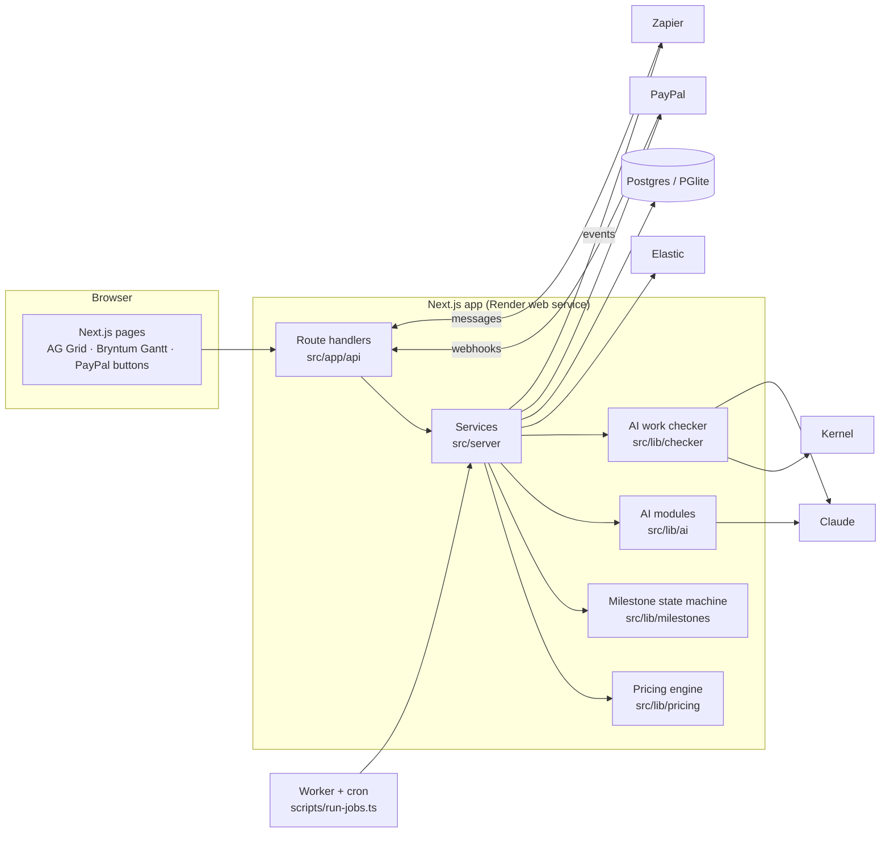
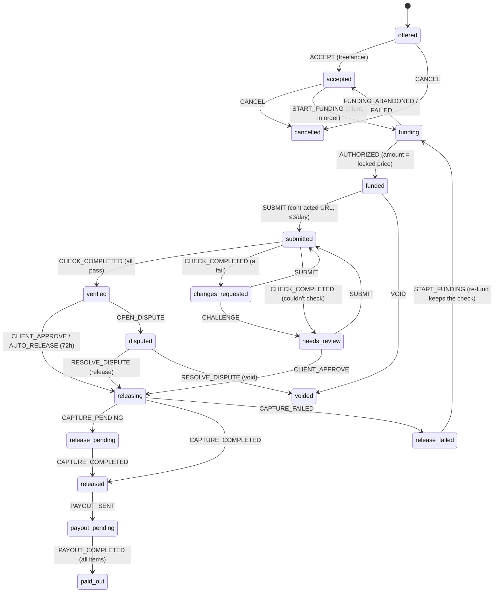
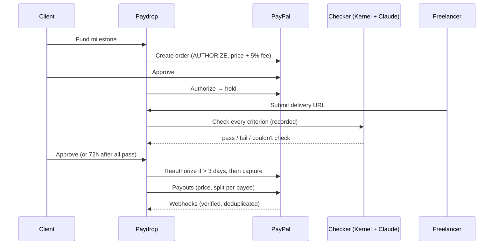

# Architecture

**Rule one: AI proposes, code decides.** Claude scopes, estimates, classifies and checks; deterministic TypeScript prices every milestone and is the only code that moves money.

## Layers

| Layer | Where | Responsibility |
| --- | --- | --- |
| Pages | `src/app/*/page.tsx`, `src/components/` | Client components that call the API; AG Grid and Bryntum load client-side only |
| API | `src/app/api/**/route.ts` | Thin handlers: parse with Zod, call a service, map errors (`src/server/http.ts`) |
| Services | `src/server/` | Party checks (only the client or freelancer of a contract can act on it), orchestration, effects |
| Domain | `src/lib/pricing`, `src/lib/milestones` | Pure, deterministic, unit-tested |
| Integrations | `src/lib/paypal`, `src/lib/ai`, `src/lib/checker`, `src/lib/search`, `src/lib/materials` | Typed clients with fallbacks |
| Data | `src/db/schema.ts`, `drizzle/` | Drizzle ORM; PGlite locally, Postgres on Render |

## The milestone state machine

`src/lib/milestones/state-machine.ts` is pure: `transition(state, event)` returns the next state plus side effects (PayPal calls, checker runs, payouts) for the caller to perform. Each event names an actor; only listed actors may send it. AI and agents can never send `CLIENT_APPROVE` or `AUTO_RELEASE`.

Persistence (`src/server/milestone-store.ts`):

- **Compare-and-set:** every write names the `version` it read; the loser of a race re-reads and retries.
- **Idempotency:** the event id is the primary key of `milestone_events`, so a replayed event is a no-op.
- **Semantic dedupe:** a capture reported twice (API response and webhook) is applied once.
- **Hooks in the same transaction** (`src/server/hooks.ts`):
  - on funding, the payout split is locked
  - on release, the verified outcome goes into the freelancer's reputation, and one payout row is queued per payee
  - when everything is settled, the contract is marked complete

## Money flow

## Pricing

`src/lib/pricing/engine.ts`, worked example in the brief:

- Task value = PERT hours × highest complexity × skill base rate, rounded to ₹50, never below the ₹300/hr floor.
- Milestone price = task value × urgency × (1 + tier premium).
- Fee = 5%, rounded per milestone.
- All money is integer paise (`src/lib/money.ts`).
- Verified Reputation Score and tiers: `src/lib/pricing/reputation.ts`.

## AI work checker

`src/lib/checker/run.ts`:

1. Open the delivery in a recorded browser: Kernel, or local Chromium.
2. Deterministic probes decide what they understand: page loads, overflow at a given width, titles and meta, sitemap, image counts, quoted text.
3. Claude drives the page with tools (open, click, fill, select, resize, record result) for interactive criteria.
4. **Merge:** if the probe and the AI disagree, the result is "couldn't check" and a person decides. Client-judged and file criteria go to the client.
5. **Injection guard:** if any page addresses the checker, no criterion can pass automatically.

Graded by `evals/checker` (see [CHECKER_EVAL.md](CHECKER_EVAL.md)).

## Data model

| Table | Holds |
| --- | --- |
| `users` | Personas, skills, verified outcomes (reputation), contact details for Zapier matching |
| `quotes` | Brief, AI scope result, model and prompt version |
| `contracts` | Parties, locked tier and standing, totals, delivery origins, collaborators, time zone |
| `milestones` | Draft (criteria), pricing, receipt, state (JSON), version, due date, locked split |
| `milestone_events` | Audit trail and idempotency |
| `check_runs` | Every checker run: steps, results, replay |
| `payouts` | One row per payee per milestone |
| `negotiations` | Counter-offers and AI re-estimates |
| `messages`, `change_requests` | Scope-creep thread and change or schedule requests |
| `deliveries` | Sites built by AI agents |
| `materials` | Channel3 items added to a milestone budget |
| `webhook_events` | Every PayPal webhook, deduplicated by PayPal's id |

## Security

- **Party checks:** every route checks the caller is a party to the contract.
- **Accounts and sessions:** passwords hashed with scrypt; sessions are random tokens in an httpOnly, SameSite=Lax cookie, stored as SHA-256 with a 30-day expiry and deleted on sign-out; sign-in is rate-limited per email and address; auth endpoints refuse cross-site origins; password reset links are single-use, expire in 30 minutes, go out through the Zapier hook and sign out every other session. `src/proxy.ts` sends signed-out visitors to sign-in; every API call still checks the session in the database. Demo personas sign in without a password (`DEMO_LOGIN=off` turns that off).
- **Webhooks:** verified with PayPal's verify-webhook-signature API; the capture is re-fetched before acting.
- **Amounts:** come from PayPal, never the browser; a mismatch voids the hold.
- **Agent sites:** served with `Content-Security-Policy: sandbox`, so their scripts run in an opaque origin.
- **Shared secrets:** Cron, admin and Zapier endpoints require them. CI runs gitleaks.
